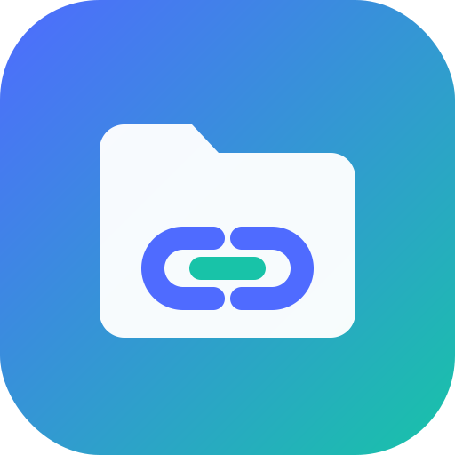

# טדרלינק פיילס – Tedralink Files

**הקבצים שלך, מכל מקום — בחיבור אחד מאובטח.**

[עברית](#עברית) · [English](#english)

## עברית

טדרלינק פיילס היא מערכת לניהול ועריכת קבצים מרחוק: מתחברים לשרתים, ל־NAS ולענן, מעיינים, מעלים, מורידים ועורכים קבצים — מהמחשב או מהטלפון, בדפדפן או באפליקציית אנדרואיד.

- 🔌 **חיבורים:** SFTP/SSH, ‏SMB (שיתופי Windows/NAS), ‏FTP/FTPS, ‏WebDAV, ‏S3, ‏Google Drive, ‏OneDrive, ‏Dropbox ותיקיות מקומיות
- ✏️ **עריכה:** עורך טקסט וקוד עם הדגשת תחביר, עריכת תמונות, תצוגה מקדימה למסמכים ומדיה
- 📦 **ארכיונים:** יצירה וחילוץ של ZIP/TAR/7z/RAR (מנוע 7-Zip מובנה)
- 📡 **SMB:** חיפוש אוטומטי של מחשבים ו־NAS ברשת, רשימת שיתופים, גישת אורח
- 🔁 **העברות ברקע, סנכרון, סל מחזור, שינוי שמות מרובה, לשוניות ותצוגה כפולה**
- 🔒 **אבטחה:** כספת מוצפנת לסיסמאות, אימות דו־שלבי (2FA), הכול רץ אצלך — בלי שרת צד שלישי
- 🌍 עברית, אנגלית, ערבית, רוסית, ספרדית וצרפתית

- ⬇️ **הורדה:** [הגרסה האחרונה](../../releases/latest)

| פלטפורמה | קובץ | הערות |
|---|---|---|
| 📱 **אנדרואיד (מומלץ)** | `TedralinkFiles-v0.2.0.apk` | אפליקציה עצמאית — השרת רץ על הטלפון, בלי מחשב. כולל גם מצב חיבור למחשב מרוחק |
| 🪟 **Windows 10/11 (מומלץ)** | `TedralinkFiles-Setup-v0.2.0.exe` | מתקין מלא בעברית/אנגלית — Python וכל הרכיבים כלולים, אייקון במגש המערכת |
| 🐧 Linux x64 | `TedralinkFiles-Linux-x64-v0.2.0.tar.gz` | גרסה ניידת, Python כלול — מריצים `./tedralink-files.sh` |
| 📱 אנדרואיד – לקוח קל | `TedralinkFiles-Remote-v0.2.0.apk` | ‏(78KB) רק מתחבר למחשב שמריץ את טדרלינק |
| 💻 קוד נייד (כל מערכת) | `TedralinkFiles-Desktop-v0.2.0.zip` | נדרש Python 3.10+; ‏`run.bat` / `./run.sh` (מתאים גם ל־macOS) |

### התקנה ב־Windows
1. מורידים ומריצים את `TedralinkFiles-Setup-v0.2.0.exe` (ייתכן ש־SmartScreen יציג אזהרה — "מידע נוסף" ← "הפעל בכל זאת").
2. בוחרים שפה, תיקייה ורכיבים: קיצור דרך בשולחן העבודה, הפעלה אוטומטית עם Windows, חוק חומת אש לרשתות פרטיות.
3. טדרלינק מופיע במגש המערכת ופותח את הדפדפן; בכניסה הראשונה בוחרים סיסמת מנהל.
4. בתפריט המגש: "גישה מהטלפון ברשת Wi-Fi" — כדי להתחבר מהטלפון. הסרה דרך "אפליקציות מותקנות".

### התקנה באנדרואיד
1. פותחים את עמוד הגרסה **בטלפון** ומורידים את `TedralinkFiles-v0.2.0.apk`.
2. פותחים את הקובץ ומאשרים "התקנת אפליקציות ממקורות לא ידועים" אם מתבקש.
3. בהפעלה הראשונה מאשרים "גישה לכל הקבצים" והתראות; בוחרים סיסמה — וזהו, הכול רץ על הטלפון (SMB, ‏SFTP, ענן, ארכיונים…).
4. בתפריט: "שיתוף ברשת ה־Wi-Fi" — כדי לגשת לקבצי הטלפון מהמחשב בדפדפן.

> אם התקנתם בעבר את ה־APK הראשון של 0.2.0, יש להסיר אותו לפני ההתקנה (חתימה חדשה).

הנתונים והסיסמאות נשמרים אצלך בלבד. המאגר מכיל קבצי התקנה בלבד; קוד המקור פרטי.
דיווח על באגים והצעות: [Issues](../../issues).

---

## English

**Tedralink Files** — *your files, everywhere, over one secure link.* A self-hosted remote file manager & editor for servers, NAS and cloud storage, in the browser (installable PWA) and on Android.

- **Connections:** SFTP/SSH, SMB, FTP/FTPS, WebDAV, S3, Google Drive, OneDrive, Dropbox, local folders
- **Editing:** code/text editor with syntax highlighting, image editor, previews
- **Archives:** create & extract ZIP/TAR/7z/RAR
- Background transfers, sync, trash, batch rename, tabs, dual pane, command palette (Ctrl+K)
- Encrypted credential vault, 2FA; runs on your own machine — no third-party server
- 6 languages (Hebrew-first)

**Downloads** ([latest release](../../releases/latest)):

- **Android (recommended):** `TedralinkFiles-v0.2.0.apk` — standalone, the whole server runs on the phone (arm64-v8a / armeabi-v7a, Android 7+); also includes the remote-PC client mode.
- **Windows 10/11 (recommended):** `TedralinkFiles-Setup-v0.2.0.exe` — Hebrew/English installer with bundled Python, tray app, "allow phone access on Wi-Fi" toggle, autostart, private-network firewall rule, uninstaller.
- **Linux x64 portable:** `TedralinkFiles-Linux-x64-v0.2.0.tar.gz` — bundled Python, run `./tedralink-files.sh`.
- **Android thin client:** `TedralinkFiles-Remote-v0.2.0.apk` — connects to a PC running Tedralink.
- **Portable source zip:** `TedralinkFiles-Desktop-v0.2.0.zip` — any OS incl. macOS, needs Python 3.10+ (`run.bat` / `./run.sh`).

Verify downloads with `SHA256SUMS.txt`.

This repository contains release files only; the source code is private.

---
Android is a trademark of Google LLC. · © 2026 Scitedra Labs · [scitedra-labs.web.app](https://scitedra-labs.web.app/tedralink-files/)
